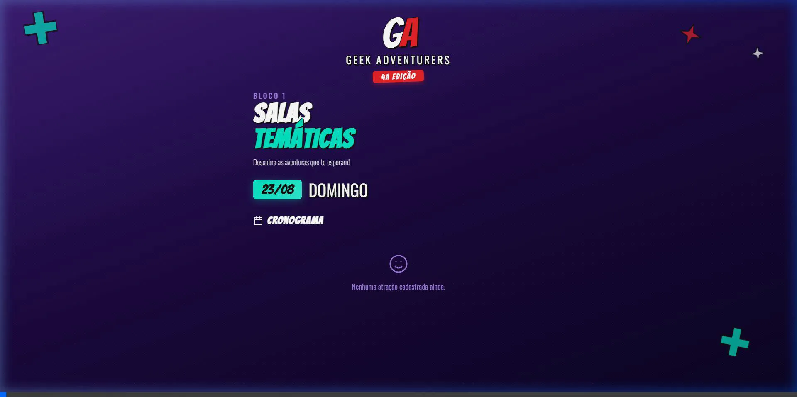
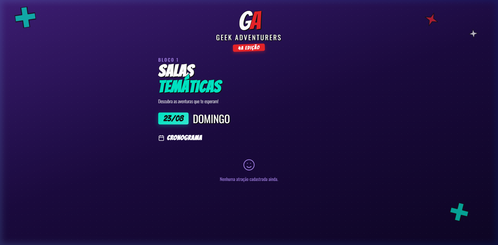
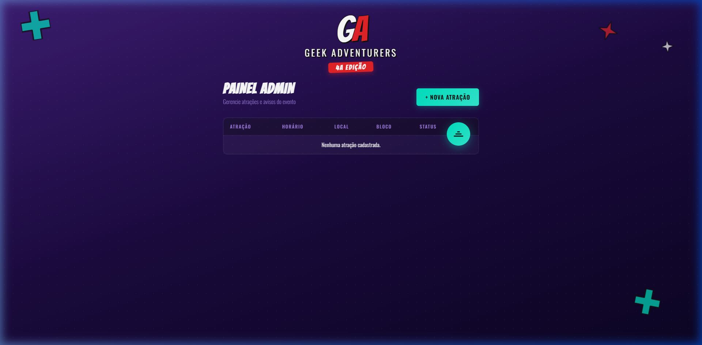

<div align="center">
  
  <h1>Geek Adventurers Companion 🎮</h1>
  <p><strong>Plataforma Logística e Operacional de Cronograma em Tempo Real</strong></p>
</div>

---

Um sistema moderno de acompanhamento de atrações criado para gerir a logística do mega evento **Geek Adventurers**. Focado em entregar uma experiência dinâmica para o público e resolver gargalos de comunicação operacional da equipa através de um painel administrativo protegido e de alta performance.

## 🎯 O Problema e a Solução (Case Logístico)

- **A Dor:** A gestão de horários em eventos ao vivo costuma ser caótica, dependendo de cronogramas impressos que ficam desatualizados no minuto em que uma atração atrasa, gerando desinformação e sobrecarga na equipa de *staff*.
- **A Solução:** Uma plataforma *real-time* que atua como a única fonte de verdade do evento. O público tem acesso instantâneo a mudanças de sala e horário, enquanto a organização controla o fluxo do evento de forma centralizada.
- **Prototipagem Ágil & IA:** A necessidade de entregar uma arquitetura complexa (WebSockets + Django + Angular) a tempo do evento exigiu agilidade extrema. A orquestração dos *containers* Docker e a base dos componentes reativos foram estruturados em poucos dias através de ciclos intensos de **Vibe Coding e Prompt Engineering avançado**, poupando dezenas de horas de desenvolvimento tradicional.

## ✨ Recursos de Automação e UX

- **Cronograma em Tempo Real**: Os visitantes acompanham horários, salas e blocos das atrações atualizados dinamicamente via WebSocket (Django Channels/Redis), eliminando a necessidade de comunicação manual.
- **Painel Administrativo Seguro**: Dashboard protegido (área restrita) que permite à equipa de operações gerir o status de cada atração de forma centralizada.
- **Avisos Instantâneos (Push)**: Um sistema de *Toasts* (balões de notificação) automatizado que avisa o público na hora quando uma atração muda de horário ou o administrador dispara um alerta crítico.
- **Design System Premium**: Interface UI/UX construída do zero, utilizando Glassmorphism e uma paleta vibrante para garantir máxima legibilidade em dispositivos móveis durante o evento.

## 📸 Telas do Sistema

### 1. Visão do Público (Cronograma)
A interface principal, pensada para ser consultada no celular ou em telões durante o evento. Exibe as atrações e o seu status (Agendado, Em Andamento, Encerrado).
<br/>


### 2. Acesso Restrito (Login)
O painel administrativo exige uma senha antes de liberar o acesso, garantindo a segurança das informações operacionais.
<br/>


### 3. Painel de Controle (Admin)
Visão completa em tabela para gestão rápida de logística. Modais elegantes são usados para edição e para disparar avisos globais instantâneos.
<br/>


## 🛠️ Tecnologias & Arquitetura

- **Frontend**: Angular 18 (Signals), HTML5, Vanilla CSS (Design System próprio).
- **Backend de Alta Concorrência**: Python 3.12, Django 5, Django REST Framework.
- **Real-Time / WebSockets**: Django Channels com Redis para comunicação instantânea.
- **Banco de Dados**: PostgreSQL (Configurado via Docker) / SQLite (Fallback local).
- **Infraestrutura**: Docker & Docker Compose para orquestração e deploy simplificado.

## 🚀 Como Rodar o Projeto (Com Docker)

A maneira mais rápida de colocar a aplicação no ar é utilizando o `docker-compose`. Ele subirá o banco de dados, o Redis, o backend e o frontend simultaneamente.

1. Clone este repositório:
   ```bash
   git clone https://github.com/MarioJamisson/GeekAventurersCompanion.git
   cd GeekAventurersCompanion
   ```

2. Suba a stack via Docker:
   ```bash
   docker-compose up --build
   ```

3. Acesse no navegador:
   - **Frontend (Público e Admin):** `http://localhost:4200`
   - Acesso Admin: `http://localhost:4200/admin` (Senha: `ga2025`)
   - **Backend API:** `http://localhost:8000/api/`

---
<div align="center">
Feito para revolucionar a logística e a experiência do <strong>Geek Adventurers!</strong> 💜
</div>
