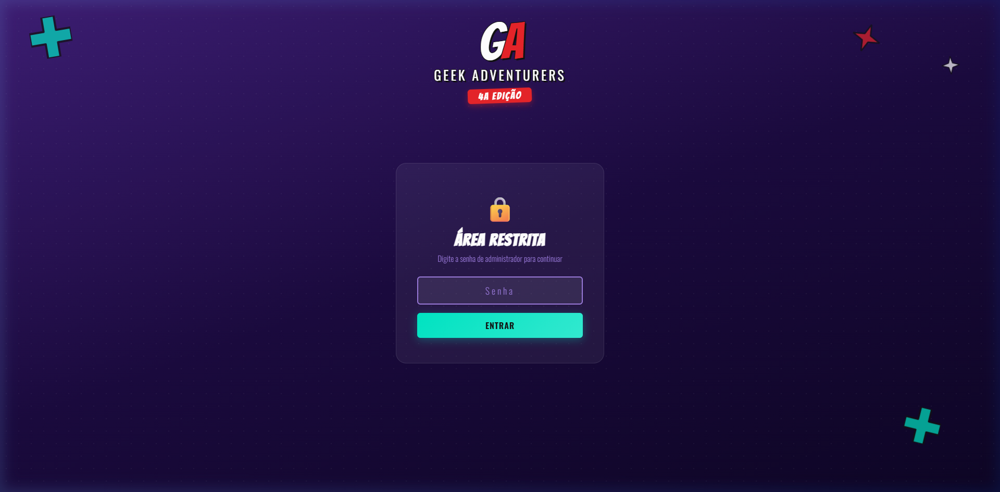

<div align="center">
  
  <h1>Geek Adventurers Companion 🎮</h1>
  <p><strong>Plataforma de Gestão de Cronograma e Avisos em Tempo Real</strong></p>
</div>

---

Um sistema moderno de acompanhamento de atrações criado para o evento **Geek Adventurers**. Focado em entregar uma experiência limpa, dinâmica e imersiva para o público, com um painel administrativo poderoso e protegido.

## ✨ Recursos

- **Cronograma em Tempo Real**: Os visitantes acompanham horários, salas e blocos das atrações atualizados dinamicamente via WebSocket, sem precisar recarregar a página.
- **Painel Administrativo Seguro**: Protegido por senha (área restrita), permite adicionar, editar e gerenciar o status de cada atração.
- **Avisos Instantâneos**: Um sistema de *Toasts* (balões de notificação) que avisa o público na hora quando uma atração muda de horário ou o administrador dispara um novo aviso manual.
- **Design System Premium**: Interface limpa e esteticamente agradável utilizando Glassmorphism, paleta roxa/ciano vibrante e tipografia *comic* refinada.

## 📸 Telas do Sistema

### 1. Visão do Público (Cronograma)
A interface principal, pensada para ser consultada no celular ou em telões durante o evento. Exibe as atrações e o seu status (Agendado, Em Andamento, Encerrado).
<br/>


### 2. Acesso Restrito (Login)
O painel administrativo exige uma senha antes de liberar o acesso, garantindo a segurança das informações.
<br/>


### 3. Painel de Controle (Admin)
Visão completa em tabela para gestão rápida. Modais elegantes (com fundo desfocado) são usados para edição e para disparar avisos globais (pelo botão flutuante).
<br/>


## 🛠️ Tecnologias Utilizadas

- **Frontend**: Angular 18 (Signals), HTML5, Vanilla CSS (Design System próprio).
- **Backend**: Python 3.12, Django 5, Django REST Framework.
- **Real-Time / WebSockets**: Django Channels com Redis.
- **Banco de Dados**: PostgreSQL (Configurado via Docker) / SQLite (Fallback local).
- **Infraestrutura**: Docker & Docker Compose.

## 🚀 Como Rodar o Projeto (Com Docker)

A maneira mais rápida de colocar a aplicação no ar é utilizando o `docker-compose`. Ele subirá o banco de dados, o Redis, o backend e o frontend simultaneamente.

1. Clone este repositório:
   ```bash
   git clone https://github.com/MarioJamisson/GeekAventurersCompanion.git
   cd GeekAventurersCompanion
   ```

2. Suba a stack via Docker:
   ```bash
   docker-compose up --build
   ```

3. Acesse no navegador:
   - **Frontend (Público e Admin):** `http://localhost:4200`
   - Acesso Admin: `http://localhost:4200/admin` (Senha: `ga2025`)
   - **Backend API:** `http://localhost:8000/api/`

---
<div align="center">
Feito para revolucionar a experiência do <strong>Geek Adventurers!</strong> 💜
</div>
